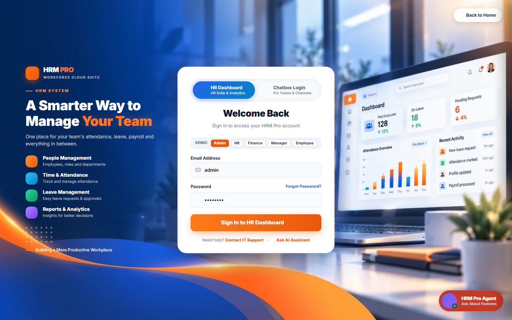
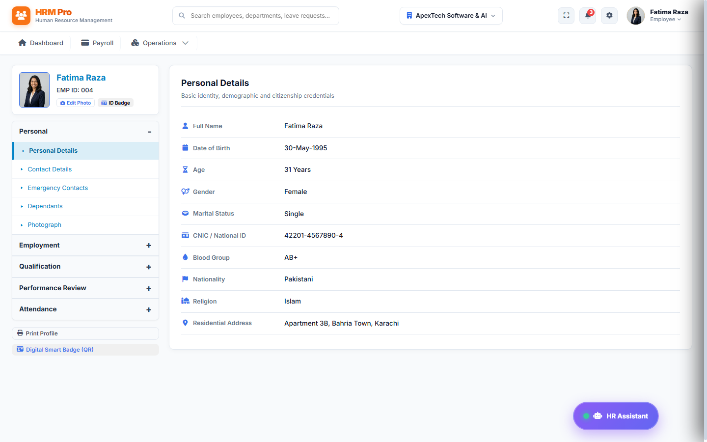
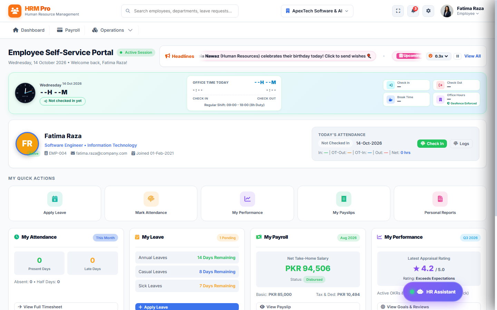
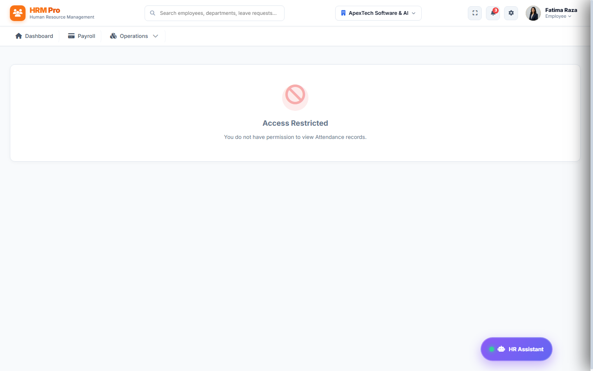
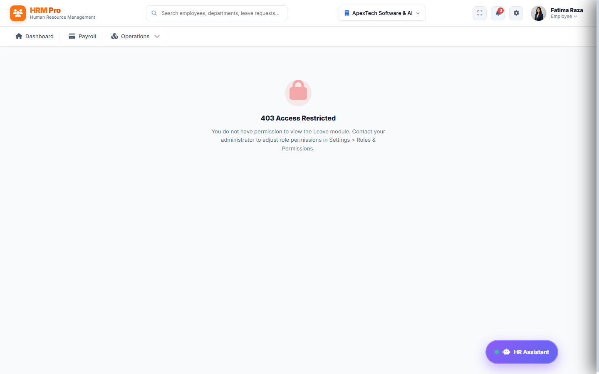
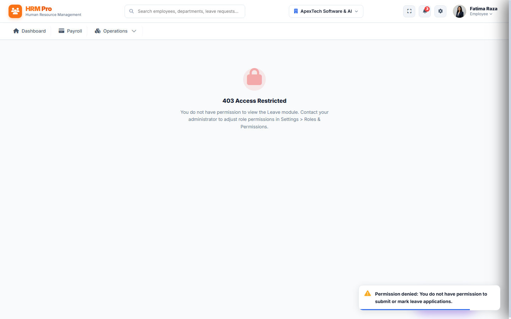
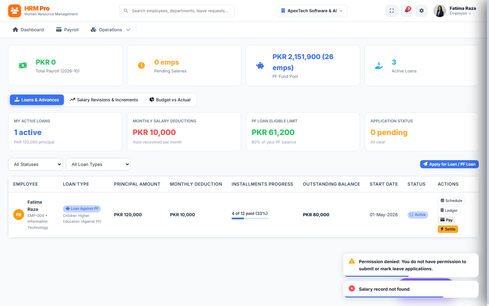
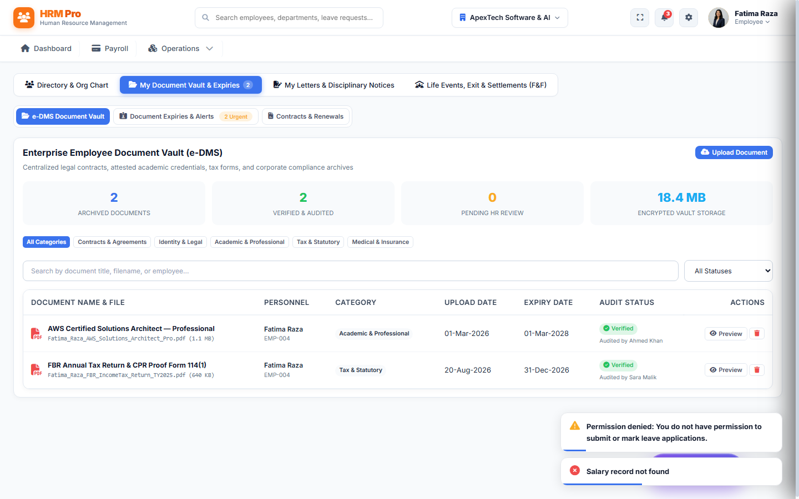
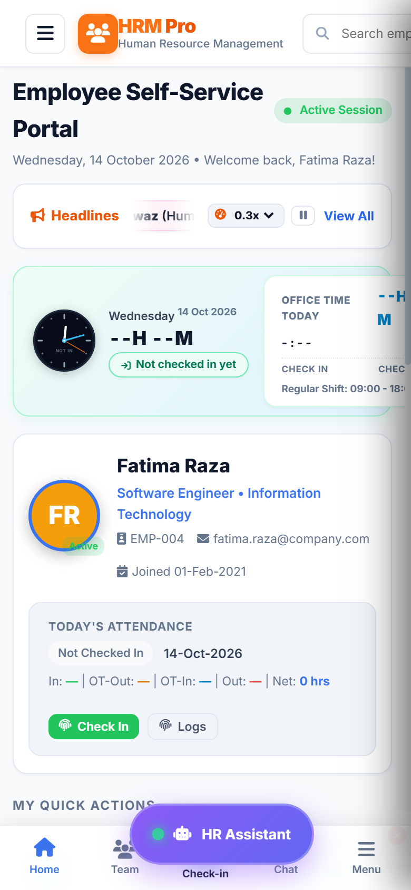

# HRM Pro Enterprise — Employee Self-Service User Manual
**Version:** v2.4.0-Enterprise  
**Target Audience:** All Permanent, Probationary, and Contract Employees  
**Document Ref:** HRM-EUM-2026  
**System URL:** `https://hrm.company.com`  

---

## Table of Contents
1. [Introduction to Employee Self-Service](#1-introduction-to-employee-self-service)
2. [Account Authentication & Secure Login](#2-account-authentication--secure-login)
3. [Employee Portal Dashboard Overview](#3-employee-portal-dashboard-overview)
4. [Personal Profile & Information Management](#4-personal-profile--information-management)
5. [Attendance Punch-In / Punch-Out Clock](#5-attendance-punch-in--punch-out-clock)
6. [Attendance History & Regularization Requests](#6-attendance-history--regularization-requests)
7. [Leave Entitlements & Balances](#7-leave-entitlements--balances)
8. [Applying for Leave & Time-Off Requests](#8-applying-for-leave--time-off-requests)
9. [Digital Payslips & Monthly Salary Breakdown](#9-digital-payslips--monthly-salary-breakdown)
10. [Electronic Document Management System (e-DMS)](#10-electronic-document-management-system-e-dms)
11. [Progressive Web App (PWA) Mobile Installation](#11-progressive-web-app-pwa-mobile-installation)
12. [Frequently Asked Questions (FAQ)](#12-frequently-asked-questions-faq)
13. [Employee Troubleshooting & Helpdesk Support](#13-employee-troubleshooting--helpdesk-support)

---

## 1. Introduction to Employee Self-Service
Welcome to **HRM Pro Enterprise**. The Employee Self-Service (ESS) portal provides you with transparent, direct access to your employment profile, real-time biometric attendance records, leave quotas, electronic payslips, and corporate documents. By utilizing this system, you eliminate paper forms and gain instant visibility into your workplace telemetry.

---

## 2. Account Authentication & Secure Login
### 1. Feature Explanation
Authentication verifies your identity using enterprise role-based authorization (RBAC). Passwords are encrypted using bcrypt (12 salt rounds), and user sessions are governed by JSON Web Tokens (JWT) with automatic idle timeout protection.

### 2. Step-by-Step Instructions
1. Open your browser and navigate to the corporate HRM Pro URL (e.g., `https://hrm.company.com`).
2. On the landing page, click the **Employee Login** or **Sign In** button on the top right navigation bar.
3. Enter your assigned corporate **Username** or corporate email address (e.g., `fatima.raza`).
4. Enter your secure **Password**.
5. Click **Sign In to Workspace**. Upon verification, the portal loads your personalized dashboard.

### 3. Screenshot

*Figure 2.1: HRM Pro Enterprise Authentication Gateway showing role selection and encrypted credential inputs.*

### 4. Expected Result
Authentication succeeds, a secure session token is established, and you are redirected to the Employee Self-Service Dashboard.

### 5. Common Problems and Solutions
- **"Invalid Credentials":** Verify caps-lock key. If forgotten, contact HR Helpdesk to trigger a one-time credential reset.
- **"Security Lockout (300s)":** After 5 consecutive failed attempts, your IP is quarantined for 5 minutes. Wait until the timer expires.

---

## 3. Employee Portal Dashboard Overview
### 1. Feature Explanation
The Employee Dashboard provides an executive summary of your current workday: live punch clock, remaining daily working hours, leave balance chips, active announcements, and upcoming company holidays.

### 2. Step-by-Step Instructions
1. Upon login, review the top greeting card displaying your official designation, department, and active status badge.
2. Inspect the **Headlines Ticker** in the top header row for urgent notices, upcoming public holidays (e.g., Iqbal Day), and company alerts.
3. Observe the **Hero Office Time Widget** displaying current server time, check-in status, and hours worked.
4. Use the **Quick Action Shortcuts** to navigate instantly to Leave Application, Attendance Log, or Payslip Vault.

### 3. Screenshot

*Figure 3.1: Employee Self-Service Dashboard with real-time punch clock, headlines ticker, and quick navigation cards.*

### 4. Expected Result
Real-time workplace status is displayed accurately with live clock synchronization.

### 5. Common Problems and Solutions
- **Headlines not moving:** Click the pause/play toggle or reload the tab to fetch the latest broadcast announcements.

---

## 4. Personal Profile & Information Management
### 1. Feature Explanation
The Profile module holds your master employment dossier: personal identification, statutory CNIC, emergency contacts, bank account for payroll disbursals, academic degrees, and professional certifications.

### 2. Step-by-Step Instructions
1. Click on your name avatar in the top right corner or click **My Profile** in the sidebar.
2. Browse through the profile sub-tabs: *Personal Details, Employment Contract, Bank & Tax, Emergency Contacts, Experience, and Skills*.
3. To update emergency contact or residential address, click **Edit Information**, modify fields, and click **Submit Change Request** for HR endorsement.

### 3. Screenshot

*Figure 4.1: Comprehensive Employee Dossier view showing personal data, organization hierarchy, and qualifications.*

### 4. Expected Result
Profile displays read-only statutory data and editable contact fields with audit timestamps.

### 5. Common Problems and Solutions
- **Bank IBAN locked:** Salary accounts cannot be edited directly by employees to prevent payroll misdirection. Submit an official IBAN proof to Accounts.

---

## 5. Attendance Punch-In / Punch-Out Clock
### 1. Feature Explanation
The digital clock interface captures exact timestamps and connects seamlessly with on-premises ZKTeco / SilkID biometric devices. If working on-site or approved for remote duty, you can register your attendance directly.

### 2. Step-by-Step Instructions
1. From your dashboard, locate the **Hero Clock Widget**.
2. Click the green **Check In** button upon commencing duty. The system logs the time and marks your status as *Present* (or *Late* if after grace threshold).
3. When departing, click the red **Check Out** button. The system calculates effective office hours and breaks.

### 3. Screenshot

*Figure 5.1: Real-time Attendance Hero Widget with analog clock, check-in timer, remaining shift duration, and break tracking.*

### 4. Expected Result
Timestamp logged, status badge updates to "Checked In", and total working duration increments every second.

### 5. Common Problems and Solutions
- **"Geofence Required":** Ensure location services are permitted in your mobile or laptop browser when checking in.

---

## 6. Attendance History & Regularization Requests
### 1. Feature Explanation
The Attendance History table logs daily punch timestamps, total hours, overtime tokens, and shift compliance for the entire month.

### 2. Step-by-Step Instructions
1. Click **Attendance** on the top navigation bar.
2. Select the desired month and year from the dropdown filters.
3. Review your attendance summary: Total Days, Present, Absents, Late Arrivals, and Overtime Hours.
4. If a punch was missed due to biometric machine sync delay or outdoor duty, click **Request Regularization** next to that date, provide justification, and submit for Manager approval.

### 3. Screenshot

*Figure 6.1: Monthly Attendance Register and shift audit log with color-coded status badges and export capabilities.*

### 4. Expected Result
Regularization request is queued for supervisory review and marked with a pending token.

### 5. Common Problems and Solutions
- **Missed punch not displaying:** Regularization must be submitted within 72 hours of the occurrence as per company policy.

---

## 7. Leave Entitlements & Balances
### 1. Feature Explanation
The Leave module tracks statutory annual entitlements under the Pakistan Factories Act & Shops & Establishments Act: Annual (Paid) Leaves, Casual Leaves, Sick/Medical Leaves, and Maternity/Paternity Entitlements.

### 2. Step-by-Step Instructions
1. Navigate to **Leave Management**.
2. Review the four metric cards displaying your Total Quota, Consumed Days, and Remaining Balances.

### 3. Screenshot

*Figure 7.1: Real-time Leave Balance summary cards and leave calendar tracker.*

### 4. Expected Result
Accurate, real-time balance computation preventing unauthorized leave overdraws.

---

## 8. Applying for Leave & Time-Off Requests
### 1. Feature Explanation
The digital leave workflow provides a paperless application process with automatic policy validation and supervisor notification.

### 2. Step-by-Step Instructions
1. Navigate to **Leave Management** and click the **Apply for Leave** button.
2. Select the **Leave Type** (Annual, Casual, Sick).
3. Choose **Start Date** and **End Date**. The system automatically computes working days, excluding weekends and official company holidays.
4. Enter a clear **Reason / Justification**. For medical leave exceeding 2 days, attach doctor certification.
5. Click **Submit Application**. The request is immediately routed to your Reporting Manager's action queue.

### 3. Screenshot

*Figure 8.1: Interactive Leave Application form with dynamic day calculation and policy validation.*

### 4. Expected Result
Application status changes to *Pending Review* and an email alert is dispatched to your supervisor.

### 5. Common Problems and Solutions
- **"Insufficient Quota":** You cannot apply for leaves exceeding your available quota without supervisor unpaid leave endorsement.

---

## 9. Digital Payslips & Monthly Salary Breakdown
### 1. Feature Explanation
Digital payslips provide a verified audit trail of your monthly compensation: Basic Pay, House Rent Allowance (HRA), Medical Allowance, Utility Allowance, Overtime additions, and statutory deductions (FBR Progressive Income Tax, EOBI, and Provident Fund).

### 2. Step-by-Step Instructions
1. Click **Payroll** or select **My Payslips** from your portal.
2. Locate the target pay period (e.g., September 2026) and click **View Payslip**.
3. Inspect the itemized salary voucher breakdown.
4. Click **Print / Download PDF** to generate a secure, digitally signed PDF for banking or visa applications.

### 3. Screenshot

*Figure 9.1: Formal Confidential Payslip voucher with itemized earnings, statutory tax withholdings, and net disbursal.*

### 4. Expected Result
Tamper-proof salary voucher rendered on official company letterhead with SHA256 digital verification.

---

## 10. Electronic Document Management System (e-DMS)
### 1. Feature Explanation
The e-DMS repository stores employee records, appointment letters, non-disclosure agreements, educational credentials, and disciplinary letters in secure encrypted cloud storage.

### 2. Step-by-Step Instructions
1. Click **Employees** &rarr; select **e-DMS Documents** tab.
2. Browse uploaded company letters and personal credentials.
3. Click **Download** to obtain official copies or **Upload Document** to submit updated degree/license certificates.

### 3. Screenshot

*Figure 10.1: Secure Electronic Document Management System (e-DMS) with upload and download facilities.*

### 4. Expected Result
Secure document inspection and instant PDF download.

---

## 11. Progressive Web App (PWA) Mobile Installation
### 1. Feature Explanation
HRM Pro is built as an enterprise Progressive Web App (PWA). You can install it on any iOS or Android device without visiting an app store, providing lightning-fast mobile punch-in, push notifications, and offline support.

### 2. Step-by-Step Mobile Installation
1. On your smartphone browser (Chrome on Android or Safari on iOS), open the HRM Pro application link.
2. On Android: Tap the **Install HRM Pro** banner or browser menu (three dots) &rarr; **Install App / Add to Home screen**.
3. On iOS: Tap the **Share** button (square with arrow) &rarr; scroll down and tap **Add to Home Screen**.
4. The HRM Pro icon appears on your home screen and operates in full-screen standalone mode.

### 3. Screenshot

*Figure 11.1: HRM Pro Mobile PWA layout showing native mobile navigation bar and responsive punch clock.*

---

## 12. Frequently Asked Questions (FAQ)
| Question | Official Resolution |
| :--- | :--- |
| **Can I cancel an applied leave?** | Yes. If the status is still *Pending*, open the leave request and click *Cancel Application*. If already approved, contact HR. |
| **How is overtime calculated?** | Approved overtime is computed automatically from verified biometric exit punches exceeding shift roster rules. |
| **Why is tax deducted from my salary?** | Tax withholding is mandated under the FBR Salaried Tax Schedule 2025-27, calculated on projected annual gross income. |

---

## 13. Employee Troubleshooting & Helpdesk Support
- **Internal Helpdesk:** Navigate to *Helpdesk & Grievance* module &rarr; click *Log Ticket*.
- **Emergency IT Support:** Email `it-support@company.com` with your Employee ID and screenshot of any error code.
