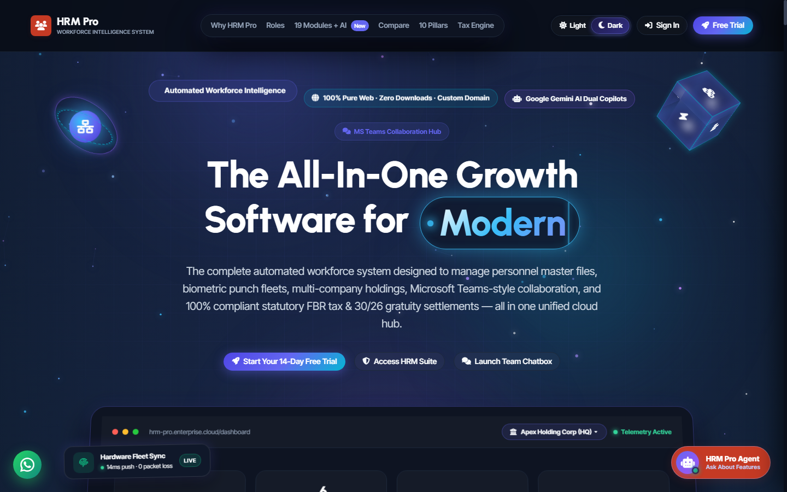
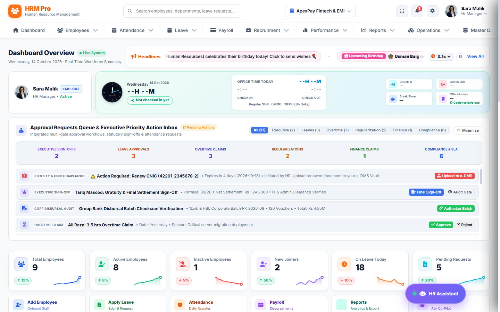
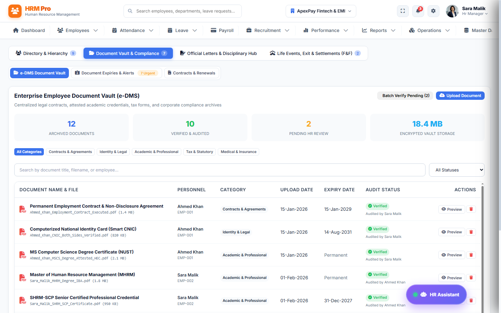
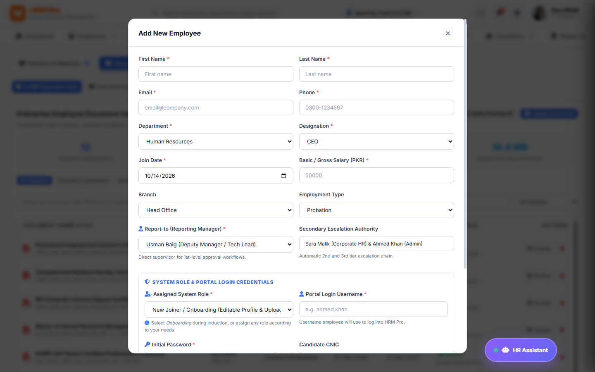
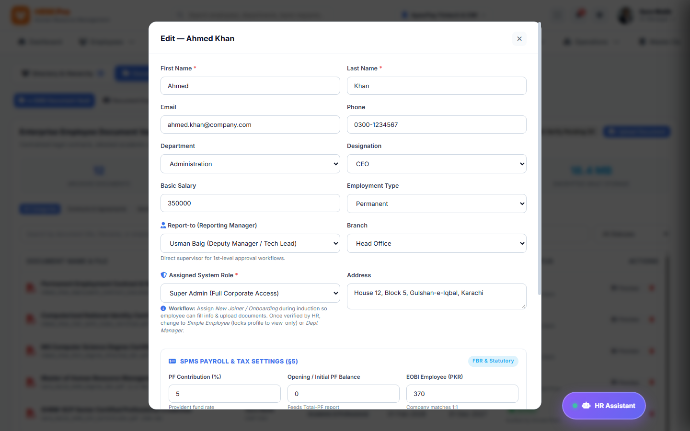
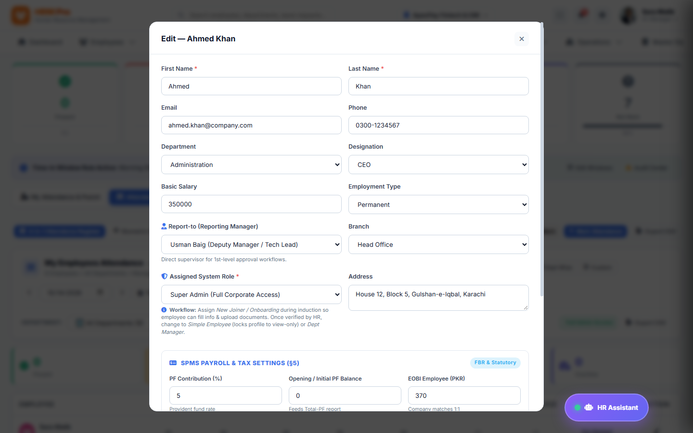
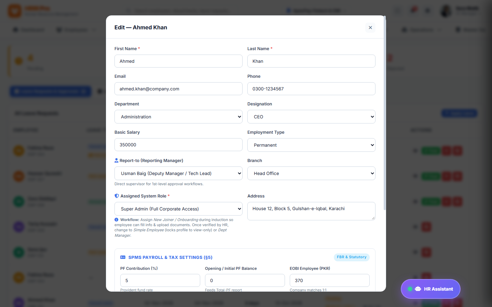
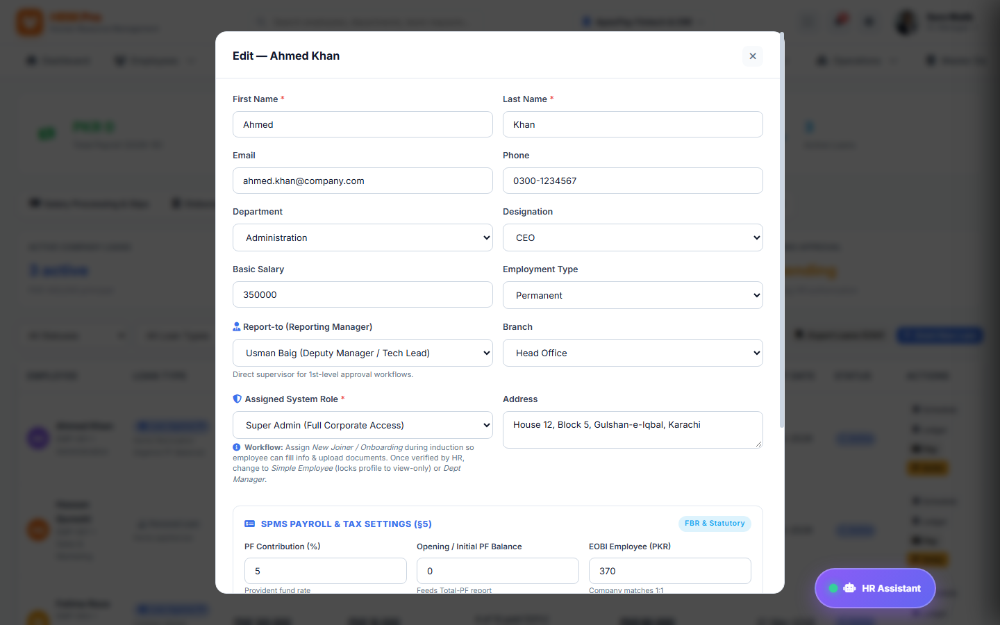
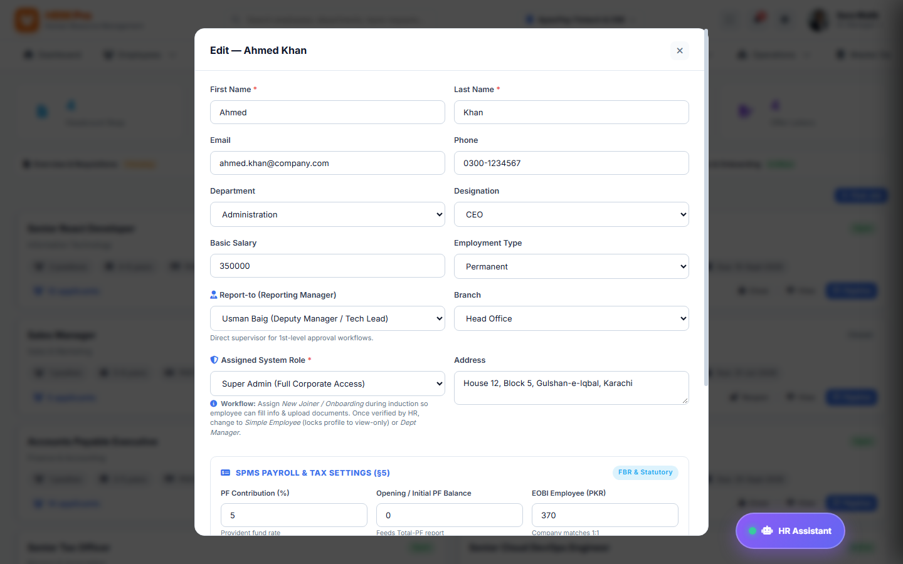
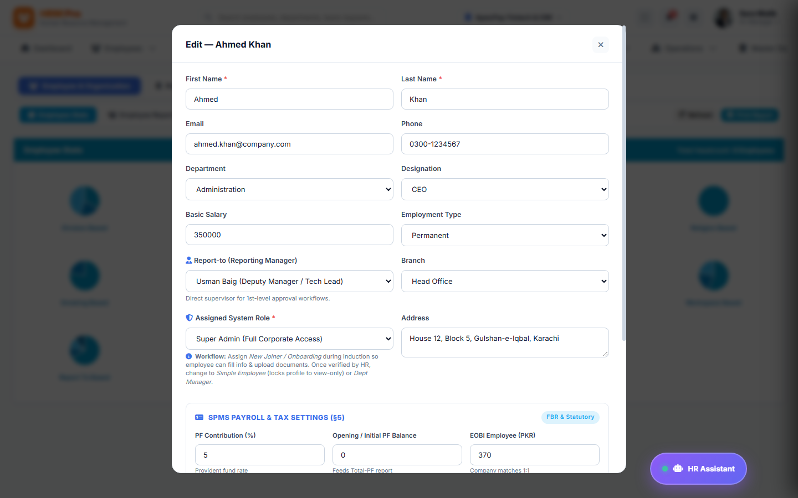

# HRM Pro Enterprise — HR Manager & Administrator Operational Guide
**Version:** v2.4.0-Enterprise  
**Target Audience:** HR Directors, People Operations Managers, Department Administrators  
**Document Ref:** HRM-HAG-2026  
**System URL:** `https://hrm.company.com`  

---

## Table of Contents
1. [HR Operational Governance & Compliance](#1-hr-operational-governance--compliance)
2. [Administrator Authentication & Privileged Access](#2-administrator-authentication--privileged-access)
3. [HR Director Executive Intelligence Dashboard](#3-hr-director-executive-intelligence-dashboard)
4. [Employee Directory & Master Roster Management](#4-employee-directory--master-roster-management)
5. [New Hire Registration & Onboarding Lifecycle](#5-new-hire-registration--onboarding-lifecycle)
6. [Employee Profile Updates, Designations & Transfers](#6-employee-profile-updates-designations--transfers)
7. [Attendance Administration & Biometric Machine Telemetry](#7-attendance-administration--biometric-machine-telemetry)
8. [Multi-Tier Leave Request Approval Action Center](#8-multi-tier-leave-request-approval-action-center)
9. [Automated Payroll Processing, FBR Progressive Tax & Bank Batches](#9-automated-payroll-processing-fbr-progressive-tax--bank-batches)
10. [Recruitment ATS, Job Openings & Candidate Pipelines](#10-recruitment-ats-job-openings--candidate-pipelines)
11. [Business Intelligence Reports, Analytics & Audit Exports](#11-business-intelligence-reports-analytics--audit-exports)
12. [HR Manager Frequently Asked Questions (FAQ)](#12-hr-manager-frequently-asked-questions-faq)
13. [Operations Troubleshooting & Exception Handling](#13-operations-troubleshooting--exception-handling)

---

## 1. HR Operational Governance & Compliance
This operational manual empowers HR Managers and Department Administrators to govern the entire employee lifecycle: talent acquisition, onboarding, time & attendance telemetry, statutory leave governance, compensation disbursal, performance evaluation, and separation settlements. Strict adherence to Pakistan labor laws and enterprise audit standards is embedded in every workflow.

---

## 2. Administrator Authentication & Privileged Access
### 1. Feature Explanation
HR Managers possess privileged credentials with access to sensitive wage data, CNIC identity records, and administrative override actions. Authentication requires role validation and logs all session activities to the system audit trail.

### 2. Step-by-Step Instructions
1. Navigate to the administrative gateway `https://hrm.company.com/#login`.
2. Select **HR Director / Administrator** role or input manager username (`sara.malik`).
3. Enter authorized password.
4. Click **Sign In**. The operational suite initializes with complete department access.

### 3. Screenshot

*Figure 2.1: Privileged HR Director authentication screen with encrypted credential tokenization.*

### 4. Expected Result
Administrator session initialized with HR Director permissions, loading full operational menus.

---

## 3. HR Director Executive Intelligence Dashboard
### 1. Feature Explanation
The HR Director Dashboard consolidates real-time workforce analytics: active headcount, present attendance percentage, on-leave metrics, new hires this quarter, and the executive **Priority Action Center** queue for pending leaves, missed punches, and overtime claims.

### 2. Step-by-Step Instructions
1. Log in as HR Director (e.g., `sara.malik`).
2. Review the **6 Real-Time KPI Cards** across total workforce, active staff, daily attendance rate, and pending requests.
3. Inspect the **Priority Action Center** to process urgent single-click approvals for leaves and regularizations.
4. Verify the top **Headlines Ticker** for cross-company announcements and scheduled events.

### 3. Screenshot

*Figure 3.1: HR Executive Dashboard featuring full-width headline announcements, KPI metrics, and action inbox.*

### 4. Expected Result
Comprehensive workforce telemetry updates automatically with live database synchronization.

---

## 4. Employee Directory & Master Roster Management
### 1. Feature Explanation
The Employee Directory provides a searchable, filterable master roster of all corporate personnel across subsidiaries, departments, designations, and contract types.

### 2. Step-by-Step Instructions
1. Click **Employees** in the top navigation.
2. Use the search bar to locate staff by Name, Employee Code, or CNIC.
3. Filter by Subsidiary Entity or Department to analyze staffing distributions.
4. Click any employee row to open their full interactive profile dossier.

### 3. Screenshot

*Figure 4.1: Master Employee Directory with department filters, status badges, and quick-action toolbars.*

---

## 5. New Hire Registration & Onboarding Lifecycle
### 1. Feature Explanation
The onboarding engine provisions complete employment records: biographical data, appointment letter generation, initial probation terms, biometric PIN assignment, and tax parameters.

### 2. Step-by-Step Instructions
1. Navigate to **Employees** module and click the blue **Add New Employee** button.
2. Fill in the mandatory fields: Full Name, Official Email, Mobile Number, CNIC (13 digits), Department, and Designation.
3. Assign the initial Employment Type (Permanent, Contract, Probation) and Joining Date.
4. Set the Base Salary and select Bank Disbursal Account Details.
5. Click **Save & Register**. The system automatically creates a user login and dispatches welcome credentials.

### 3. Screenshot

*Figure 5.1: Add New Employee Modal Form with statutory identity validation and compensation setup.*

### 4. Expected Result
Employee record created, biometric ID allocated, and welcome onboarding packet emailed.

---

## 6. Employee Profile Updates, Designations & Transfers
### 1. Feature Explanation
The Edit Employee modal allows HR Managers to update contract terms, promote staff, adjust reporting lines, or update compensation.

### 2. Step-by-Step Instructions
1. Locate employee in directory &rarr; click **Edit**.
2. Modify designation, salary increment, or transfer to another department.
3. Save record to maintain a historical audit log of career progression.

### 3. Screenshot

*Figure 6.1: Edit Employee Profile dialog with department reassignment and audit tracking.*

---

## 7. Attendance Administration & Biometric Machine Telemetry
### 1. Feature Explanation
HRM Pro integrates natively with physical ZKTeco, SilkID, and TCP/IP biometric machines. The Attendance Administration dashboard displays daily registers, shift rosters, overtime rosters, and device synchronization health.

### 2. Step-by-Step Instructions
1. Click **Attendance** on the top navigation bar.
2. Filter records by date or department to monitor punctuality, lates, and absences.
3. Review the **Biometric Sync Status** card to confirm real-time gateway communication.
4. Export the monthly attendance summary to CSV or Excel for payroll verification.

### 3. Screenshot

*Figure 7.1: Enterprise Attendance Management Console with daily registers and biometric gateway logs.*

---

## 8. Multi-Tier Leave Request Approval Action Center
### 1. Feature Explanation
Centralized leave governance portal where Department Managers and HR Directors endorse or reject leave applications based on quota availability and department shift coverage.

### 2. Step-by-Step Instructions
1. Navigate to **Leave Management** &rarr; **Approval Queue**.
2. Inspect pending requests showing employee name, leave type, date range, and remaining quota.
3. Click the green **Approve** button to finalize endorsement, or red **Reject** with comments.
4. Approved leaves automatically decrement employee balances and reflect on attendance registers.

### 3. Screenshot

*Figure 8.1: Multi-tier Leave Approval console with instant status actions and balance validation.*

---

## 9. Automated Payroll Processing, FBR Progressive Tax & Bank Batches
### 1. Feature Explanation
The Payroll Engine automates gross-to-net computation for hundreds of staff in seconds. It calculates progressive salaried tax under FBR 2025-27 schedules, statutory EOBI, and generates 6 standard commercial banking disbursal formats (1Link, HBL, Alfalah, Meezan).

### 2. Step-by-Step Instructions
1. Click **Payroll** from the top navigation bar.
2. Select the current payroll month (e.g., September 2026).
3. Click **Run Payroll Calculation**. The engine computes gross salary, deductions, and net pay.
4. Click **Generate Disbursal Batch** and select bank format (e.g., *1Link Universal Format*).
5. Click **Email Payslips** to dispatch password-protected salary slips to all employees simultaneously.

### 3. Screenshot

*Figure 9.1: Comprehensive Payroll Dashboard with FBR tax computation, batch disbursals, and payslip generation.*

---

## 10. Recruitment ATS, Job Openings & Candidate Pipelines
### 1. Feature Explanation
The Applicant Tracking System (ATS) manages open job vacancies, candidate resumes, interview scheduling, scoring scorecards, and offer letter generation.

### 2. Step-by-Step Instructions
1. Navigate to **Recruitment** module.
2. Click **Create Job Opening** to publish vacancies.
3. Drag and drop candidate cards through hiring stages (*Applied &rarr; Screened &rarr; Interviewed &rarr; Offered*).
4. One-click convert selected candidates directly into employee dossiers.

### 3. Screenshot

*Figure 10.1: Recruitment ATS Kanban Pipeline displaying candidate stages from Screening to Offer Issued.*

---

## 11. Business Intelligence Reports, Analytics & Audit Exports
### 1. Feature Explanation
The Reports BI module delivers interactive analytical dashboards for workforce turnover, salary expense distributions, attendance trends, and statutory compliance audits.

### 2. Screenshot

*Figure 11.1: Business Intelligence Analytics Dashboard with interactive charts and CSV/PDF export engines.*

---

## 12. HR Manager Frequently Asked Questions (FAQ)
| Operational Scenario | Recommended Action |
| :--- | :--- |
| **How do I adjust an employee salary mid-year?** | Open the employee profile &rarr; click *Edit* &rarr; update Base Salary. The tax engine automatically adjusts progressive brackets. |
| **Can I reverse a finalized payroll run?** | Superadmin authorization is required to unlock a finalized pay period and re-run calculations. |

---

## 13. Operations Troubleshooting & Exception Handling
- **Biometric Offline Troubleshooting:** If the biometric machine shows offline in the attendance gateway, verify network IP connectivity and restart the Node-ZKLib listener in Server Administration.
