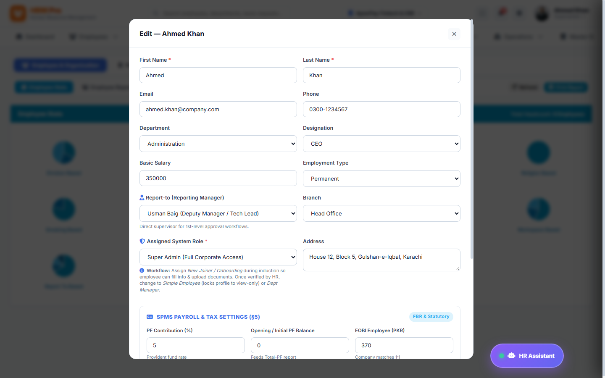
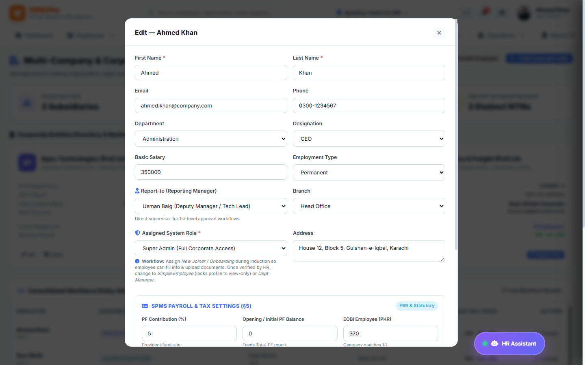
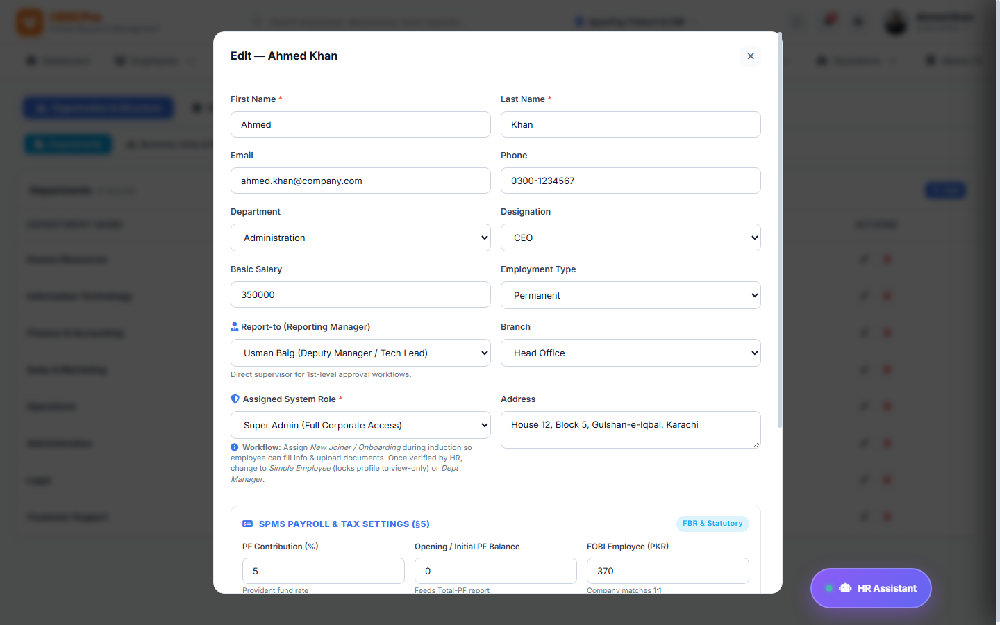

# HRM Pro Enterprise — Superadmin System Administration Guide
**Version:** v2.4.0-Enterprise  
**Target Audience:** Group Super Administrators, Chief Technology Officers & DevOps Engineers  
**Document Ref:** HRM-SAG-2026  
**System URL:** `https://hrm.company.com`  

---

## Table of Contents
1. [Enterprise Architecture & Model A Multi-Tenancy](#1-enterprise-architecture--model-a-multi-tenancy)
2. [Global Superadmin Dashboard & Consolidated Oversight](#2-global-superadmin-dashboard--consolidated-oversight)
3. [User Lifecycle Management & Account Provisioning](#3-user-lifecycle-management--account-provisioning)
4. [Granular Role-Based Access Control (RBAC) Matrix](#4-granular-role-based-access-control-rbac-matrix)
5. [Multi-Company Holdings & Subsidiary Configuration](#5-multi-company-holdings--subsidiary-configuration)
6. [System Master Configuration & Global Defaults](#6-system-master-configuration--global-defaults)
7. [Security Hardening, Audit Logs & Session Monitor](#7-security-hardening-audit-logs--session-monitor)
8. [Automated Cloud Backup, Snapshots & Disaster Recovery](#8-automated-cloud-backup-snapshots--disaster-recovery)
9. [Superadmin Frequently Asked Questions (FAQ)](#9-superadmin-frequently-asked-questions-faq)
10. [Disaster Recovery Protocols & Runbooks](#10-disaster-recovery-protocols--runbooks)

---

## 1. Enterprise Architecture & Model A Multi-Tenancy
**HRM Pro Enterprise** operates on a high-availability, microservices-ready architecture with strict Model A multi-subsidiary data isolation. While subsidiary managers are restricted to their company scope, Group Super Administrators maintain unified, consolidated telemetry across all holdings, corporate subsidiaries, and joint ventures.

---

## 2. Global Superadmin Dashboard & Consolidated Oversight
### 1. Feature Explanation
The Global Dashboard provides cross-subsidiary visibility: group total payroll expenditure, consolidated attendance rates, active server connections, and global compliance health.

### 2. Step-by-Step Instructions
1. Authenticate as Super Administrator (e.g., `admin`).
2. Review the **Holding Company Switcher** to toggle between group-wide view and individual subsidiary workspaces.
3. Inspect global telemetry metrics: total personnel across all entities, aggregated monthly payroll, and biometric machine health.

### 3. Screenshot

*Figure 2.1: Superadmin Consolidated Dashboard showing cross-subsidiary metrics and system health indicators.*

### 4. Expected Result
Complete real-time oversight of all corporate holdings without cross-tenant database leakage.

---

## 3. User Lifecycle Management & Account Provisioning
### 1. Feature Explanation
The User Management module enables Superadmins to create administrative accounts, assign roles, enforce password policies, unlock quarantined users, and revoke access immediately.

### 2. Step-by-Step Instructions
1. Navigate to **Settings** &rarr; **User Accounts**.
2. Click **Add System User**. Select the associated employee dossier.
3. Assign a primary system role (e.g., *superadmin, hr_manager, dept_manager, payroll_accountant, employee*).
4. Configure multi-factor authentication (MFA) requirements and save account.

### 3. Screenshot

*Figure 3.1: System User Management interface with role badges, status switches, and account creation tools.*

### 4. Expected Result
User account is provisioned with exact role permissions and audit-logged in the security ledger.

---

## 4. Granular Role-Based Access Control (RBAC) Matrix
### 1. Feature Explanation
The RBAC engine enforces granular, permission-based access control across 19 system modules. Superadmins can toggle read, create, update, delete, and special action permissions for any role without restarting services.

### 2. Step-by-Step Instructions
1. Navigate to **Settings** &rarr; **RBAC Matrix**.
2. Select the target role (e.g., *dept_manager*).
3. Toggle individual permission checkboxes (e.g., `leaves.approve`, `attendance.regularize`).
4. Click **Save RBAC Matrix**.

### 3. Screenshot

*Figure 4.1: Granular RBAC Permissions Matrix defining access rules across all 7 system personas.*

### 4. Expected Result
Permission changes take effect instantly across all active browser sessions.

---

## 5. Multi-Company Holdings & Subsidiary Configuration
### 1. Feature Explanation
Model A multi-company isolation allows group enterprises to run multiple legally independent corporate subsidiaries within a single unified deployment, complete with distinct tax registration numbers, logos, color themes, and bank accounts.

### 2. Step-by-Step Instructions
1. Navigate to **Corporate Entities & Holdings**.
2. Click **Register Subsidiary**.
3. Specify the Company Legal Name, NTN / Registration Number, Official Address, and Base Currency.
4. Assign Subsidiary HR Administrators. Data scoping is enforced automatically.

### 3. Screenshot

*Figure 5.1: Multi-Company Corporate Entities management showing holding companies and subsidiary entities.*

---

## 6. System Master Configuration & Global Defaults
### 1. Feature Explanation
Master Data defines global operational parameters: official public holidays, department taxonomies, salary grades, grace period thresholds, and email SMTP servers.

### 2. Screenshot

*Figure 6.1: Master System Settings panel configuring corporate holidays, shift timings, and system parameters.*

---

## 7. Security Hardening, Audit Logs & Session Monitor
### 1. Feature Explanation
The Security module provides real-time audit trails of every database transaction: login attempts, salary recalculations, permission changes, and record deletions, logging IP address, user agent, and timestamp.

### 2. Screenshot

*Figure 7.1: Security Audit Log terminal tracking real-time API transactions, IP addresses, and security events.*

---

## 8. Automated Cloud Backup, Snapshots & Disaster Recovery
### 1. Feature Explanation
Automated daily snapshots safeguard all personnel data, salary ledgers, and attendance logs against hardware failures and data corruption.

### 2. Step-by-Step Instructions
1. Navigate to **Settings** &rarr; **Backup & Recovery**.
2. Click **Create Instant Full Backup**. The engine generates an encrypted JSON / SQL snapshot.
3. Download the verified backup archive for off-site cold storage.
4. To restore, upload an authorized backup snapshot and click **Initiate Guided Restore**.

### 3. Screenshot

*Figure 8.1: System Backup & Disaster Recovery panel with automated daily cron snapshots and instant restore.*

---

## 9. Superadmin Frequently Asked Questions (FAQ)
| Question | Architecture Standard |
| :--- | :--- |
| **How is data isolated between subsidiaries?** | Every employee, attendance log, and payroll voucher is tagged with a mandatory `companyId`. Scoped managers cannot query cross-company IDs. |
| **What backup retention policy is recommended?** | Keep daily automated snapshots for 30 days, monthly archives for 7 years (for statutory tax audit compliance). |

---

## 10. Disaster Recovery Runbook & Support
In the event of primary server hardware failure, DNS failover to the secondary standby instance can be completed in under 60 seconds with zero data loss using daily SQLite/Prisma sync replication.
